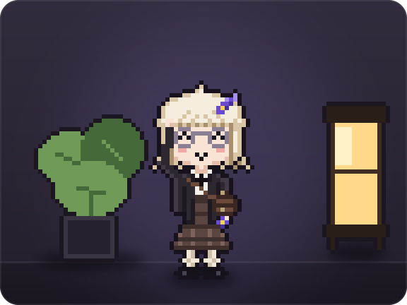
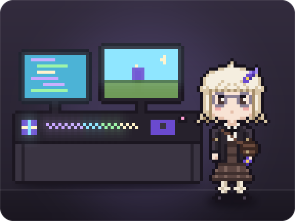
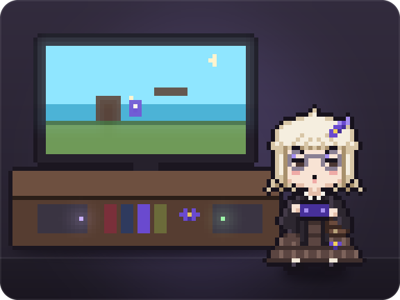
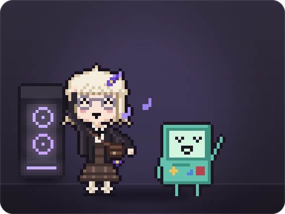
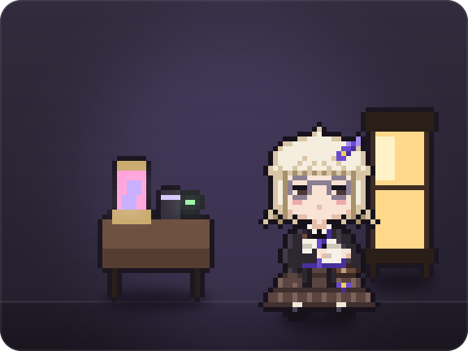
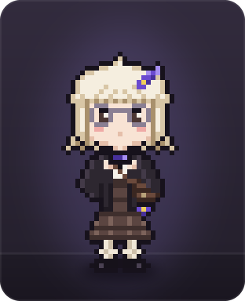
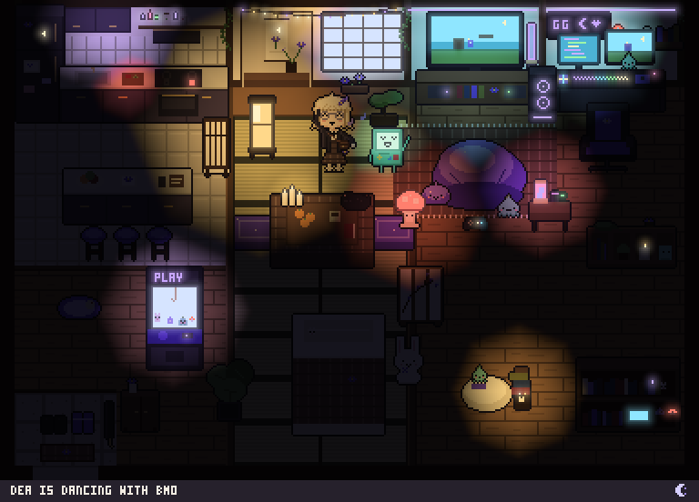

<h1>Dea <samp>· Nagy István Bence</samp></h1>

<samp>COMPUTER ENGINEERING · ÓBUDA UNIVERSITY</samp>

Research software, mostly: the tools between a person in a VR headset and the data a lab can publish. On the side I build the things I wish existed for free.

<samp><a href="https://www.linkedin.com/in/nagy-istv%C3%A1n-bence-54b2681b0/">LINKEDIN ↗</a> · <a href="https://deawebdesign.netlify.app/">DESIGN PORTFOLIO ↗</a> · BIOTECH LAB · BUDAPEST</samp>

 

## <samp>SELECTED WORK</samp>

### <a href="https://github.com/Deatron01/VRTelemetry">VRTelemetry</a>

<samp>PYTHON · TYPESCRIPT · ELECTRON</samp>

A research instrument for VR studies. Records eye tracking, pose, physiology and hardware state to Parquet at headset rate, scores SSQ / NASA-TLX, and keeps recording when the lab network drops.

<samp><a href="https://github.com/Deatron01/VRTelemetry">REPO ↗</a> · <a href="https://github.com/Deatron01/vrtelemetry-plugin-biosensor">BIOSENSOR PLUGIN ↗</a> · <a href="https://github.com/Deatron01/vrtelemetry-plugin-ros-unity-bridge">ROS / UNITY PLUGIN ↗</a></samp>

  

### <a href="https://github.com/Deatron01/vr-robot-bridge">vr-robot-bridge</a>

<samp>C# · PYTHON · ROS · UNITY</samp>

Streams live headset and controller poses into a Gazebo / MoveIt robot hand and mirrors it in a Unity XR scene. OpenXR → REP-103 → Unity coordinate conversion, covered by tests.

<samp><a href="https://github.com/Deatron01/vr-robot-bridge">REPO ↗</a></samp>

  

### <a href="https://github.com/Deatron01/Project-Mimir">Project Mimir</a>

<samp>FASTAPI · NODE · POSTGRES · RAG</samp>

Documents in, exam questions out. Semantic chunking and RAG over a vector store, JSON-schema guards against hallucination, and Moodle XML / PDF export.

<samp><a href="https://github.com/Deatron01/Project-Mimir">REPO ↗</a> · <a href="https://mimir-ai.hu/">MIMIR-AI.HU ↗</a></samp>

  

### <a href="https://github.com/Deatron01/TinyTribe">TinyTribe</a>

<samp>UNITY 6 · C# · PYTORCH · ONNX</samp>

A village survival sim whose villagers are trained, not scripted. A CNN + LSTM policy learns by imitation, DAgger and PPO in a deterministic C# simulator, then plays in-game through ONNX.

<samp><a href="https://github.com/Deatron01/TinyTribe">REPO ↗</a></samp>

  

### <a href="https://github.com/Deatron01/AIWorkGroup">AIWorkGroup</a>

<samp>PYTHON · DOCKER · OLLAMA</samp>

A fully local multi-agent software foundry. Boss, designer, worker, tester and integrator agents coordinate over an event bus, with human checkpoints and a live dashboard.

<samp><a href="https://github.com/Deatron01/AIWorkGroup">REPO ↗</a></samp>

  

### <a href="https://github.com/Deatron01/FreeTex">FreeTex</a>

<samp>JAVASCRIPT · CODEMIRROR 6 · ELECTRON</samp>

Why pay to compile LaTeX? An Overleaf-style editor for the browser or desktop, with its own compile server, local-first projects and BibTeX-aware autocompletion.

<samp><a href="https://github.com/Deatron01/FreeTex">REPO ↗</a> · <a href="https://github.com/Deatron01/FreeTex/releases/latest">DOWNLOAD ↗</a></samp>

  

## <samp>SMALL TOOLS</samp>

<table>
  <tr>
    <td align="center" width="25%"> <a href="https://github.com/Deatron01/PhoneMirror"><b>PhoneMirror</b></a> Self-hosted phone mirroring.</td>
    <td align="center" width="25%"> <a href="https://github.com/Deatron01/AdBlocker"><b>AdBlocker</b></a> Blocks ads. Collects nothing.</td>
    <td align="center" width="25%"> <a href="https://github.com/Deatron01/Photoshop"><b>Photoshop</b></a> A WPF image editor.</td>
    <td align="center" width="25%"> <a href="https://github.com/Deatron01/ZizgoKereso"><b>ZizgoKereso</b></a> Where's Zizgő?</td>
  </tr>
</table>

## <samp>STACK</samp>

<picture><source media="(prefers-color-scheme: light)" srcset="https://skillicons.dev/icons?i=python,cs,ts,js,cpp,latex,unity,ros,blender,electron,fastapi,postgres,docker,linux&perline=14&theme=light" /></picture>

## <samp>DEA, RIGHT NOW</samp>

  

<samp>BUDAPEST TIME · ASLEEP 00:00–06:00</samp>

<i>Little chaos in a quiet mind.</i>

